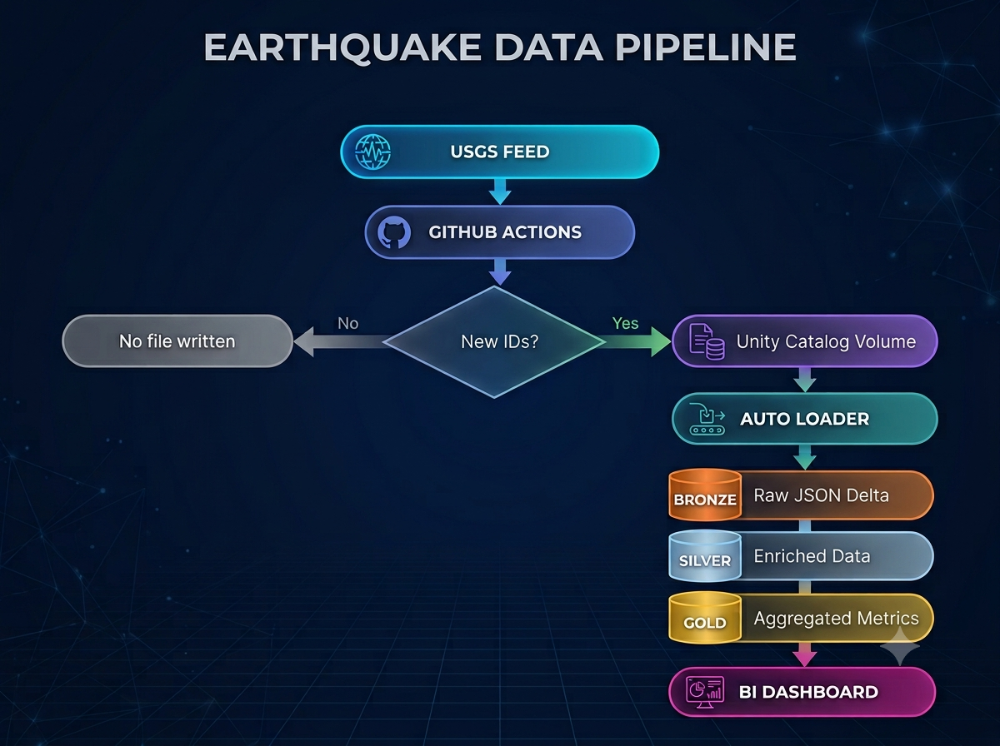

# Real-Time Earthquake Data Platform

A production-style Databricks data engineering pipeline that ingests
real-time earthquake events from the USGS public feed and processes
them through a Bronze / Silver / Gold Delta Lake architecture, with
geospatial enrichment and a connected BI dashboard.

## Overview

This project simulates an organization that needs to monitor
worldwide earthquake events continuously. It ingests the official
USGS real-time GeoJSON feed, processes only new events using an
event-ID based incremental strategy, enriches each event with
country/continent information via geospatial lookups, and maintains
incremental daily metrics for a BI dashboard. Built using free-tier
resources only.

## Architecture



External ingestion runs as plain Python via GitHub Actions calling the
Databricks REST API — Spark and `dbutils` are not used in that layer.

## Tech Stack

| Layer | Tools |
|---|---|
| Data Source | USGS real-time earthquake GeoJSON feed |
| External Ingestion | Python, GitHub Actions, Databricks REST API |
| Platform | Databricks Free Edition, Serverless compute, Unity Catalog, Unity Catalog Volumes |
| Storage | Delta Lake |
| Processing | PySpark, Spark SQL, Auto Loader, Structured Streaming, Delta MERGE |
| Geospatial | Databricks geospatial functions (ST_POINT, ST_CONTAINS, etc.) |
| Orchestration | Databricks Workflows / Jobs |
| Dashboard | Google Data Studio / Looker Studio |

## Key Features

- **Event-ID based incremental ingestion**: the external GitHub
  Actions process compares the current USGS feed against a
  `processed_earthquake_ids` state table in Databricks, and only
  writes a new JSON file when new events exist — no file is created
  on a run with zero new events.
- **External ingestion decoupled from Spark**: GitHub Actions calls
  the Databricks REST API directly over plain Python/HTTP, keeping
  ingestion independent of Databricks compute.
- **Geospatial enrichment**: each earthquake's longitude/latitude is
  converted to a point geometry and spatially joined against a
  country-boundary GeoJSON dataset to derive country and continent,
  with explicit fallback values (`International Waters`, `Unknown`)
  when no match is found.
- **Delta MERGE for both Silver and Gold**: Silver upserts events by
  earthquake ID (insert new, update existing); Gold incrementally
  merges new daily aggregates (counts, magnitude/depth stats) rather
  than rebuilding the full historical result on every run.
- **Orchestrated, monitored pipeline**: Bronze → Silver → Gold runs as
  a Databricks Job with task dependencies, retry configuration, and
  failure email notifications.

## Setup / How to Run

```bash
# Clone the repo
git clone <your-repo-url>
cd <repo-name>

# Prerequisites:
#   - A Databricks workspace (Free Edition) with Unity Catalog
#   - A Volume for incoming JSON: /Volumes/workspace/earthquake_live_feed/incoming/
#   - A state table: workspace.earthquake_live_feed.processed_earthquake_ids
#   - GitHub Secrets configured with Databricks host/token/SQL Warehouse ID

# External ingestion (runs on a GitHub Actions schedule):
#   eq_data_ingest.py

# Databricks notebooks/jobs, run in order:
#   03_bronze_autoloader
#   04_silver_json_parsing / MERGE
#   09_gold_incremental_processing
```

## Challenges & Solutions

A few of the real issues hit during development:

- **Databricks SQL API returned HTTP 400** — the SQL Warehouse ID
  configured in GitHub Secrets was incorrect. Fixed by correcting the
  warehouse ID; a valid host and token alone weren't enough.
- **`ProcessingTime` streaming trigger unsupported on Serverless** —
  the available Serverless environment didn't support the intended
  time-based trigger. Switched to `AvailableNow` and controlled
  execution through Databricks job scheduling instead.
- **Auto Loader `schemaLocation` misconfiguration** — the initial
  Bronze setup pointed schema-management state at the wrong path.
  Fixed by giving it a dedicated, stable Volume path, kept separate
  from the streaming checkpoint location.
- **Dashboard date filter didn't affect Silver** — Silver and Gold
  didn't share a common date field, so a shared date control
  wouldn't filter both. Fixed by adding an `event_date` column to
  Silver, populated from the earthquake event timestamp.

## BI link

link:https://datastudio.google.com/s/vzBbuAPR-m4

Note: Dashboard sync 12 hrs once
## Current Status / Roadmap

- ✅ USGS `all_day` GeoJSON feed integrated
- ✅ Event-ID based incremental ingestion (GitHub Actions + Databricks REST API)
- ✅ Bronze via Auto Loader
- ✅ Silver: parsing, validation, geospatial enrichment, Delta MERGE
- ✅ Gold: incremental daily earthquake metrics
- ✅ Databricks Job orchestration with retry and failure notifications
- ✅ Dashboard connected (KPI cards, heat map, country/continent) 
